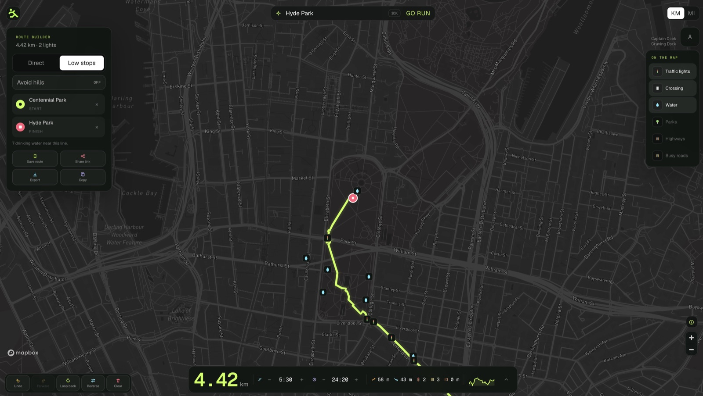
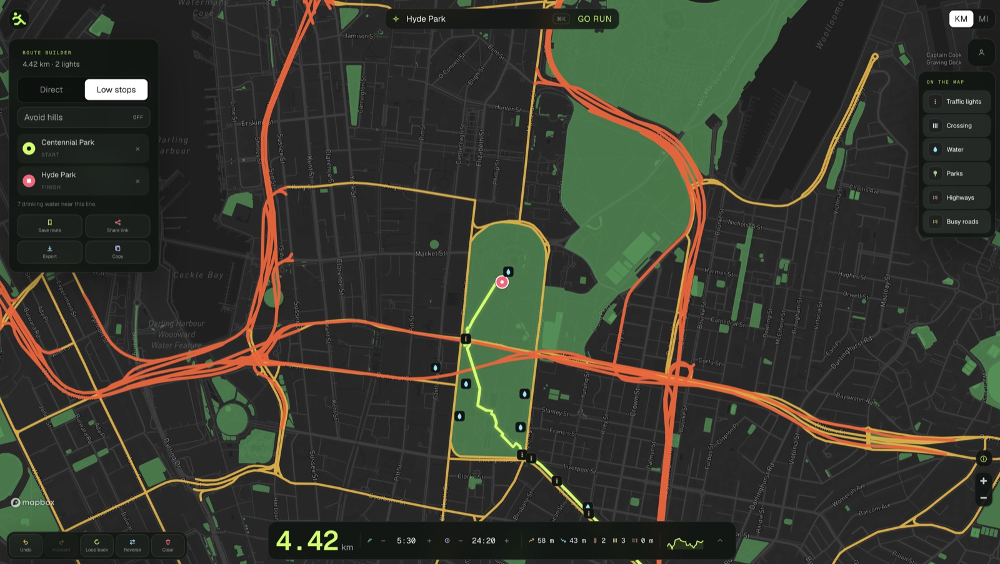

<p align="center">
  
</p>

<h1 align="center">Run Without Stops</h1>

<p align="center">
  Plan quieter running routes. Skip the lights, highways, and busy streets.
</p>

<p align="center">
  <a href="https://www.runwithoutstops.com">runwithoutstops.com</a>
  ·
  <a href="https://github.com/pratyush-okay/run-without-stops/actions/workflows/ci.yml"></a>
</p>

<p align="center">
  
</p>

Other maps give you a run. They do not keep you moving. **Run Without Stops** is a free, Sydney-first planner for pedestrian lines with fewer interruptions — built as a single Next.js app.

## What it does

Drop a start, a finish, and as many checkpoints as you need. The map can take the shortest walk, or a **Low stops** line that ducks traffic lights. Turn on the things you care about: lights, crossings, drinking water, parks, highways, and busy roads.

<p align="center">
  
</p>

- **Search or click.** Find a Sydney place, use your location, or tap the map. Nearby start points snap into a loop.
- **Direct or Low stops.** GraphHopper custom pedestrian routing, with a public Valhalla fallback for local work.
- **On the map.** Live OpenStreetMap signals, crossings, and water, plus park / highway / busy-road overlays.
- **Keep the line.** Distance, time, elevation, undo / redo, reverse, and a 50-stop cap so the route stays readable.
- **Take it with you.** Save (optional sign-in), share a link, copy a summary, or export GPX, PNG, and SVG. Completely free.

## Stack

| Area | Tools |
| --- | --- |
| App | Next.js 16 App Router, React 19, TypeScript |
| UI | Tailwind CSS 4, Geist, dark Mapbox GL map |
| Routing | GraphHopper, Valhalla fallback |
| Places & OSM | Stadia geocoding, Nominatim fallback, Overpass / Tracestrack |
| Accounts | Clerk (optional Google sign-in) |
| Data | Supabase (profiles and saved routes) |
| Observability | PostHog, Sentry |
| Quality | Biome, Vitest, Husky, GitHub Actions |

## Setup

Node **20+**. Package manager is **pnpm** only.

```bash
pnpm install
cp .env.example .env.local
pnpm dev
```

Open [http://localhost:3000](http://localhost:3000).

The map needs `NEXT_PUBLIC_MAPBOX_ACCESS_TOKEN` (restrict it to your domains in Mapbox). Search still falls back to Nominatim, and routing falls back to a public Valhalla development endpoint, when GraphHopper and Stadia keys are unset.

Public OSM endpoints are for low-volume development only. Set `TRACESTRACK_API_KEY` to use the managed Overpass service for traffic lights, crossings, and drinking water. Clerk, Supabase, PostHog, and Sentry are optional — the planner works without them.

See [`.env.example`](.env.example) for every variable.

## Scripts

| Command | What it does |
| --- | --- |
| `pnpm dev` | Next.js dev server |
| `pnpm check` | Typecheck, lint, test, and production build |
| `pnpm lint` / `pnpm lint:fix` | Biome check / autofix |
| `pnpm format` | Biome format |
| `pnpm typecheck` | `tsc --noEmit` |
| `pnpm test` | Vitest |
| `pnpm build` | Production build |

Husky runs **lint-staged** (Biome) on commit. CI on `main` and pull requests runs the same `check` gate.

## Repository layout

```
src/app/                 pages and API routes
src/app/api/             search, routing, OSM features, saved routes, share links
src/components/          dashboard, brand, auth
src/lib/routing/         GraphHopper / Valhalla adapters, GPX / SVG export
src/lib/osm/             cached runner-feature queries
src/lib/schemas/         shared Zod request / response schemas
src/env.ts               validated environment variables
assets/brand/            marks, favicons, social images
.github/workflows/       CI
```

Coding conventions live in [`.cursor/rules/`](.cursor/rules/). Brand rules live in [`assets/brand/brand.md`](assets/brand/brand.md).
